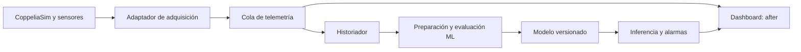

# Revisión técnica e investigación

Fecha: 16 de noviembre de 2026. Alcance: los tres scripts originales y la carpeta de datos local, que estaba vacía. No se encontró escena CoppeliaSim, dataset, notebook, modelo ML ni historial propio de Git. Las conclusiones describen ese alcance; no suponen que otros archivos externos estén disponibles.

## Diagnóstico

La aplicación es una base inicial de interfaz SCADA y simulación de señales. La separación conceptual entre supervisión, calidad, mantenimiento y eventos es adecuada, y la interfaz ya contempla reorganización al cambiar de tamaño. La vía de integración por ZeroMQ está planteada.

La brecha principal es funcional: la interfaz y el lector son procesos sin intercambio de datos. El dashboard presenta textos estáticos, los KPI permanecen en `--` y el registro solo contiene mensajes iniciales. La navegación lateral son etiquetas. No existe inspección automática ni inferencia ML. Con estos archivos aún no puede demostrarse un gemelo sincronizado con un activo físico ni mantenimiento predictivo validado.

## Hallazgos priorizados

| Prioridad | Evidencia original | Implicación y acción |
| --- | --- | --- |
| Alta | El dashboard no importa ni consume el lector | Conectar adquisición con un contrato de telemetría; mostrar conexión y antigüedad del dato |
| Alta | No hay escena `.ttt`, Lua ni contrato de unidades | No se puede reproducir la integración; versionar escena y documentar sensores |
| Alta | No hay almacenamiento | No existe trazabilidad de piezas, alarmas ni series para entrenar |
| Alta | No hay modelos ni evaluación | Presentar mantenimiento ML como objetivo pendiente |
| Alta | El estado sintético se elige antes de generar variables | Clasificación sobre distribuciones inventadas; no evidencia de anticipación de fallas |
| Media | Altura leída como int32 sin escala | Confirmar tipo en la escena y documentar unidad antes de fijar tolerancias |
| Media | Scripts con ejecución al importarse | Impide reutilización y pruebas sin efectos secundarios; corregido en la reorganización |
| Media | Lectura infinita sin límite de espera declarado | Puede bloquear ante ausencia del servidor; añadido timeout y límite opcional de muestras |
| Media | Sin dependencias, README, pruebas ni exclusiones | Instalación y publicación poco reproducibles; añadidos en esta revisión |
| Baja | Texto secundario oscuro y descripciones largas sin ajuste | Mejorado contraste y ajuste de texto; revisar visualmente en resoluciones objetivo |

## Arquitectura propuesta

Esta arquitectura es una siguiente etapa; las conexiones de este diagrama todavía no están implementadas.

Ejecutar las operaciones de red fuera del hilo gráfico. Entregar mensajes mediante una cola acotada y actualizar widgets con `after()` desde el hilo de Tkinter. Definir política de descarte, cierre del worker, reconexión y estado obsoleto. Separar dato recibido, decisión de calidad, alarma por regla y predicción ML. SQLite es una opción inicial razonable para un historiador local; fijar retención y campos antes de elegir almacenamiento de mayor escala.

Para el MVP, registrar timestamp UTC, tiempo de simulación, sesión, activo/pieza, variables, unidad, origen y calidad del dato. La consulta secuencial actual no garantiza sincronización de sensores; evaluar stepping para experimentos controlados, sin mezclarlo accidentalmente con una simulación libre. La API oficial utiliza `client.require('sim')`, adoptado en el lector reorganizado. [Documentación oficial de ZeroMQ](https://manual.coppeliarobotics.com/en/zmqRemoteApiOverview.htm).

## Inspección de calidad

Primero definir qué se inspecciona: altura fuera de tolerancia, pieza ausente, deformación o defecto superficial. Presencia y altura pueden soportar control dimensional básico si están calibradas, pero no permiten demostrar detección de defectos visuales. Para esto último se necesitan imágenes y anotaciones pertinentes.

Crear un identificador por pieza mediante transición del sensor, asociar medidas mientras ocupa la estación y emitir una única decisión con razón y tolerancia versionada. Definir qué ocurre con datos ausentes o piezas superpuestas. Validar con piezas conformes y defectuosas, casos de frontera, matriz de confusión, falsos rechazos y defectos no detectados. Los límites deben provenir de requisitos del producto, no de valores arbitrarios del generador.

## Mantenimiento y metodología ML

### Formular el objetivo

Distinguir diagnóstico del estado actual de predicción futura. `Normal/Alerta/Falla` clasifica una condición; anticipar una falla exige una etiqueta como «falla confirmada en los próximos H minutos» y ejemplos con historial previo al evento. Estimar vida útil restante requiere trayectorias con referencia temporal de falla y tratamiento de observaciones censuradas. Elegir un solo objetivo inicial y una falla concreta, por ejemplo un rodamiento degradado, justificando qué señales permiten observarla.

### Construir evidencia

Capturar campañas independientes con carga, velocidad, condiciones operativas, intervenciones y fallas verificadas. Mantener un grupo de prueba con condiciones no vistas. El generador actual es útil para probar software y el flujo de un clasificador, pero no tiene dinámica de desgaste ni validación física. Una precisión alta con él describiría el generador, no la planta.

En vibración, definir frecuencia de muestreo, banda y método de medida. Una magnitud sintética en mm/s cada 0.2 s no equivale a una señal de acelerómetro apta para análisis espectral. Si se incorporan RMS, curtosis o energía por bandas, fijar primero la adquisición y las ventanas físicas que les dan significado.

### Validar sin fuga de información

Separar por tiempo y por campaña/activo antes de formar ventanas. Evitar que ventanas solapadas o piezas de una misma secuencia entren en entrenamiento y prueba. Ajustar escalado, imputación y selección de variables solo con entrenamiento. Para series ordenadas, `TimeSeriesSplit` evita entrenar con futuro y evaluar con pasado; exige muestras igualmente espaciadas para comparar duraciones. No resuelve por sí mismo separación por activo ni purga de ventanas solapadas. [Referencia oficial de scikit-learn](https://scikit-learn.org/stable/modules/generated/sklearn.model_selection.TimeSeriesSplit.html).

Comparar primero una regla física y un clasificador sencillo, por ejemplo regresión logística o Random Forest, con el mismo protocolo. Informar recall de fallas, precision, PR-AUC, falsas alarmas por hora y tiempo de anticipación; añadir matriz de confusión para clasificación. No depender solo de accuracy cuando las fallas son poco frecuentes. La selección final debe basarse en datos disponibles, coste de error y latencia medida, no en complejidad del modelo.

### Integrar el resultado

Versionar modelo, variables, unidades, ventana temporal, dataset de entrenamiento y métricas. Distinguir un score de una probabilidad calibrada. Mostrar «sin diagnóstico» cuando faltan señales y medir latencia y antigüedad de entrada. Validar un cambio de modelo en reproducción de sesiones antes de usarlo en la supervisión.

## Hoja de ruta con criterios de aceptación

| Etapa | Entregable | Criterio observable |
| --- | --- | --- |
| 1. Escena reproducible | Escena, Lua, versiones y unidades | Otra persona reproduce las señales siguiendo el README |
| 2. Supervisión conectada | Worker, cola, UI y desconexión | Presencia cambia en pantalla; al perder conexión no quedan datos presentados como vigentes |
| 3. Historiador y calidad | Sesiones, piezas, eventos y reglas | Cada decisión puede rastrearse hasta medidas y tolerancias |
| 4. Experimento ML | Datos, partición, baseline y métricas | Evaluación independiente por tiempo/campaña; comparación con reglas |
| 5. Inferencia | Modelo versionado y presentación | Reproduce sesiones con latencia medida y maneja datos incompletos |

## Cambios realizados en esta reorganización

- Código dividido en `scada/dashboard.py`, `scada/conexion.py` y `scada/generador.py`, con entradas originales conservadas.
- Importaciones sin creación de ventanas, conexión o generación automática.
- Lector configurable con límite de espera, salida JSON y conservación de señales ausentes.
- Generador reproducible y CSV identificado como sintético, con protección contra sobrescritura accidental.
- Dependencias declaradas, configuración de empaquetado, exclusiones, guía de GitHub y workflow de verificación.
- Pruebas de contratos de lectura, generación, importación y CLI.

No se añadieron conexión al dashboard, persistencia, reglas de calidad ni entrenamiento ML: estas funciones requieren contratos y datos que no estaban presentes. La reorganización prepara su desarrollo sin presentar objetivos de investigación como resultados obtenidos.

## Verificación local realizada

- 12 pruebas unitarias aprobadas, sin escena ni ventanas.
- Compilación de todos los módulos y entradas sin errores.
- `pip check` sin conflictos en el entorno local.
- Dashboard construido, actualizado y cerrado en 1200×720 y 850×550, sin errores de callbacks de distribución.
- Lector probado contra un endpoint ZeroMQ local sin respuesta: terminó con código 1 y mensaje de timeout, sin traceback.
- Exclusiones de Git verificadas para `.venv` y CSV generados; listado publicable limitado a código, configuración y documentación.

Límites: la herramienta de captura de la interfaz no respondió; la verificación de ventanas fue programática y no sustituye una inspección visual. No se validó la comunicación con una escena CoppeliaSim real ni la matriz de GitHub Actions en servidores remotos.
